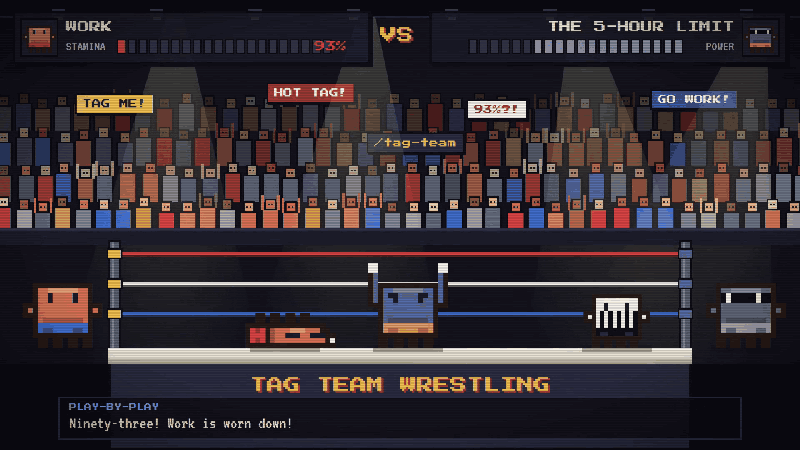
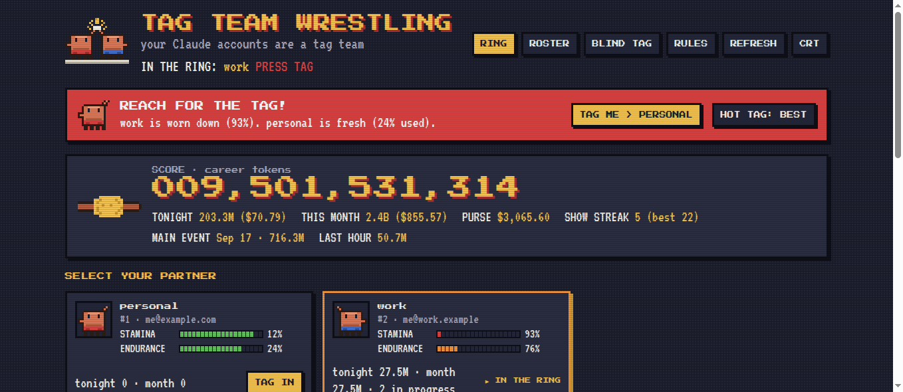

# Tag Team Wrestling

**Your Claude accounts are a tag team.** If you have more than one Claude account, say one for work and one personal, Tag Team Wrestling puts them side by side like a wrestling tag team: one partner is in the ring (the account Claude Code is using), the other waits on the apron. It shows each account's **stamina** (5-hour usage limit) and **endurance** (weekly limit) as life bars, keeps a retro **match history** of your token use, and switches the account Claude Code uses with one click: **TAG ME**.

Built on [claude-swap](https://github.com/realiti4/claude-swap) (`cswap`). Works in the Claude Code terminal, in VS Code / VSCodium / Cursor, and in your browser.

[](https://n1th1n-19.github.io/Tag-Team/#watch)

▶ **[Watch the full match with sound](https://n1th1n-19.github.io/Tag-Team/#watch)** (98 s, with commentary and captions) · [download the MP4](docs/media/tag-team.mp4)



## How the match works

| In the ring | What it means |
|---|---|
| **In the ring** | the account Claude Code is using right now (the "legal partner") |
| **On the apron** | your other signed accounts, waiting for a tag |
| **Stamina / endurance** | the 5-hour and weekly usage limits, drawn as fighting-game life bars that drain |
| **Worn down** | stamina used past your **tag-out point** (90% by default) |
| **Down for the count / K.O.** | a limit is used up (100%) |
| **TAG ME** | the button that appears when you're worn down: one press tags in the freshest partner |
| **Tag in / tag out / hot tag** | switch to a partner / hand off / tag the partner with the most stamina left |
| **Blind tag** | switches automatically to another partner, by default the one with the most stamina left, or the one whose weekly limit resets soonest if you choose that (off unless you turn it on); the **corner man** keeps it running with Claude Code closed |
| **Roster, sign, ring name, bench, release** | your accounts, adding one, its alias, leaving it out of blind tags, removing it |
| **Match history** | a year of daily token use by Claude Code on this computer, GitHub-style; **career** totals, **purse** (API-price estimate), **show streak**, **main event** |
| **Before the bell** | usage from before Tag Team started keeping score |

`tagteam rules` prints this glossary any time.

## What you get

- **The ring** (retro pixel-art dashboard): the mascot on an attract screen, an arcade **score** of your career tokens, every partner as a character-select card with stamina and endurance life bars and a K.O. stamp, a year of match history (cold → hot), high scores by month, your moveset (models) and venues (projects), and matches in progress.
- **Match cards**: tokens per Claude Code session for the last 7 days, with its title, partner, length, fresh tokens and purse (subagents count toward their session). Running sessions are marked **LIVE**, and the Claude Code pane shows **THIS MATCH** for the session it's open in.
- **TAG ME**, wherever you are:
  - *Editors*: the status bar `[IN] work ▮▮▮▯▯ 41%` turns into a red **TAG ME** button (one click tags out), with a notification offering *TAG ME > partner*, *Hot tag: best* and *Open the ring*.
  - *Claude Code terminal*: a **REACH FOR THE TAG!** bar above the prompt with a TAG ME button.
  - *Claude Code chat in editors*: `/tag-team` replies with the roster and the `/tag-out` hint. Editor chat panels can't show plugin buttons, so the button lives in the extension's status bar.
- **Blind tag**: switches partners for you using claude-swap's own engine (cooldowns, hysteresis, no bouncing back). By default it picks the partner with the most stamina left; you can choose the one whose weekly limit resets soonest instead. Off unless you turn it on.
- **Roster**: sign the current login, bring in a new partner via `/login`, sign by contract (a `claude setup-token` token or API key, passed on stdin), ring names, bench, release.
- **Status line** for Claude Code: `[IN] work · ▮▮▮▯▯ stamina 41% · endurance 79% · tonight 236M`.
- **Export** of the match history as CSV or JSON.

## Download and install

**One line** (downloads the latest release, checks it against the release's `SHA256SUMS.txt`, then runs the installer):

```bash
# macOS / Linux
curl -fsSL https://github.com/n1th1n-19/tag-team/releases/latest/download/get.sh | bash
# uninstall
curl -fsSL https://github.com/n1th1n-19/tag-team/releases/latest/download/get.sh | bash -s -- --uninstall
```

```powershell
# Windows (PowerShell)
irm https://github.com/n1th1n-19/tag-team/releases/latest/download/get.ps1 | iex
# uninstall
$env:TAGTEAM_UNINSTALL=1; irm https://github.com/n1th1n-19/tag-team/releases/latest/download/get.ps1 | iex
```

Pin a version with `TAGTEAM_VERSION=v0.4.2` in front of `bash` (or `$env:TAGTEAM_VERSION="v0.4.2"` on Windows). Prefer to read before you run? Download `get.sh` / `get.ps1` from the release, look at it, then run it.

`SHA256SUMS.txt` catches a broken or swapped download, but it lives in the same release. To check that a file was built by this repo's GitHub Actions and not uploaded by hand, use [GitHub CLI](https://cli.github.com) 2.49 or newer (releases from v0.2.2 on):

```bash
gh release download -R n1th1n-19/Tag-Team -p get.sh
gh attestation verify get.sh -R n1th1n-19/Tag-Team && bash get.sh
```

Every release is installed and uninstalled for real on macOS, Linux and Windows (PowerShell 5.1) in CI before it is published.

**Or download a zip:**

You need [Claude Code](https://claude.com/claude-code). The installer sets up everything else: uv, Python 3.12, claude-swap, the `tagteam` command, the Claude Code plugin, and the editor extension for any VS Code, VSCodium or Cursor it finds.

If uv is missing, the installer downloads a pinned uv release (0.12.13) for your OS and CPU and checks it against its SHA-256 before running anything; on a mismatch it stops and installs nothing.

| System | Download | Install |
|---|---|---|
| macOS | [tag-team-macos.zip](https://github.com/n1th1n-19/tag-team/releases/latest/download/tag-team-macos.zip) | unzip, then `./install/install.sh` |
| Linux | [tag-team-linux.zip](https://github.com/n1th1n-19/tag-team/releases/latest/download/tag-team-linux.zip) | unzip, then `./install/install.sh` |
| Windows | [tag-team-windows.zip](https://github.com/n1th1n-19/tag-team/releases/latest/download/tag-team-windows.zip) | unzip, then `powershell -ExecutionPolicy Bypass -File install\install.ps1` |
| Editor only | [tag-team.vsix](https://github.com/n1th1n-19/tag-team/releases/latest/download/tag-team.vsix) | *Extensions: Install from VSIX…* (needs `tagteam` installed) |

From source: `git clone https://github.com/n1th1n-19/tag-team && cd tag-team && ./install/install.sh`.
Plugin only, at a Claude Code prompt: `/plugin install tag-team --marketplace n1th1n-19/tag-team`.

**Coming from swap-me?** The installer removes swap-me (command, plugin, extension, service) and your history in `~/.swap-me` moves to `~/.tag-team` the first time `tagteam` runs. `swapme` still works for this version and points you to `tagteam`.

Uninstall: the one-liner above, or `./install/install.sh --uninstall` (`install.ps1 -Uninstall`). It removes the `tagteam` command, the Claude Code plugin, the editor extension and the corner man; claude-swap (`cswap`) stays. Your match history in `~/.tag-team` is kept; delete that folder to remove it too.

## First match

1. Sign the account you're logged in as: `tagteam sign --ring-name work`
2. Bring in a partner: run `/login` in Claude Code, log in to the other account, then `tagteam sign --ring-name personal`
3. Open the ring: `/tag-team` in Claude Code, click `[IN]` in your editor's status bar, or `tagteam ring` for the browser.

## Updates

`tagteam update` installs the newest release: the `tagteam` command, the Claude Code plugin and the editor extension, all at the same version. It downloads that release's installer from GitHub, which checks the zip against `SHA256SUMS.txt` before installing anything, exactly like the one-liner. `tagteam update --check` only tells you whether there's a newer release.

`tagteam auto-update on` does that for you once a week (a systemd user timer on Linux, a LaunchAgent on macOS, a Task Scheduler task on Windows); it installs only when there's a newer release. `tagteam auto-update off` stops it, and uninstalling removes it. Auto-update is off unless you turn it on. On Windows the update finishes in its own window, since `tagteam.exe` can't replace itself while it's running.

## Commands

Claude Code: `/tag-team` (the ring) · `/tag-in [N|ring name|best]` · `/tag-out` (hot tag) · `/roster` (ring card in the chat) · `/blind-tag on|off|preview|status`. Fallbacks for older Claude Code: `/tag-team:ring-card`, `/tag-team:tag-in`, `/tag-team:ring`, `/tag-team:sign`. You can also just ask Claude ("who's got the most stamina?", "tag me out"); the bundled skill knows the moves.

Terminal:

```bash
tagteam                          # ring card: mascot, score, roster with life bars, match history
tagteam tag-in work              # tag a partner in (number, ring name, email, or best)
tagteam tag-out                  # hot tag to the freshest partner
tagteam roster
tagteam sign --ring-name work    # sign the current login; --contract signs a token (read from stdin)
tagteam ring-name 2 work | bench 2 | unbench 2 | release 2
tagteam blind-tag on|off|status|preview|set threshold 85
tagteam corner-man install       # keep blind-tagging with Claude Code closed
tagteam tag-out-point 85         # when TAG ME appears
tagteam ring                     # the ring in your browser (127.0.0.1)
tagteam rules                    # the glossary
tagteam export --csv -o history.csv
tagteam update                   # install the newest release (--check to just look)
tagteam auto-update on           # check once a week and install new releases
tagteam statusline               # for Claude Code's statusLine setting
```

## How it works

**Where the numbers come from.** The life bars and the match history measure different things, so they won't line up if you also use Claude outside Claude Code:

| Number | Source | Covers |
|---|---|---|
| Stamina, endurance, TAG ME | Anthropic's usage API, through claude-swap | **All of Claude** on that account: chat (web, desktop, mobile), Claude Code (terminal, IDE, desktop, web), Claude Design, Cowork and other Claude apps |
| Score, match history, match cards, purse, streaks | Claude Code transcripts on this computer | **Claude Code on this computer only**: the terminal, VS Code / Cursor / JetBrains, and Agent SDK apps. Claude chat, Claude Design, Cowork and Claude Code on the web leave no local log. |

Most of the score is usually **cache reads**: every turn, Claude Code re-sends the conversation so far, and the API serves it from cache. The ring shows that share and the **fresh** tokens (input, output and cache writes) under the score.

- **Tokens** come from Claude Code's own transcripts (`~/.claude/projects/**/*.jsonl`): each assistant message carries its usage. Tag Team counts each message once and adds them up by night, partner and model, reading only new lines each refresh.
- **Career totals survive cleanup.** Claude Code deletes old transcripts; Tag Team keeps a daily ledger in `~/.tag-team/ledger.json`.
- **Who was in the ring when.** Transcripts don't record the account, so Tag Team logs who was in the ring at every refresh and tag. Sessions started with `cswap run N` always count for partner N.
- **Tags** go through claude-swap's JSON interface (`cswap list --json`, `cswap switch --json`, `cswap auto --once --json`), which handles the locking, keychain or credentials file, and token refresh.
- **Purse** prices tokens at public API rates. It's an estimate of what the tokens would cost on the API, not what a Pro or Max plan charges.

## Use it within Anthropic's terms

Tag Team is for switching between Claude accounts you legitimately have, like a work account and a personal one. It never shares your login with anyone, proxies requests or resells access: it only changes which of your own logins Claude Code uses, on your machine.

Our advice: don't sign up for extra accounts to get around usage limits. Anthropic's [Usage Policy](https://www.anthropic.com/legal/aup) restricts using multiple accounts to avoid detection or to get around its guardrails, and its [Consumer Terms](https://www.anthropic.com/legal/consumer-terms) let it suspend accounts it believes break the rules. Read them yourself; you're responsible for how your accounts are used.

## Privacy and security

- Your match history stays on your machine. Tag Team's only network call is to GitHub's releases API, and only when you run `tagteam update` or turn on auto-update (claude-swap calls Anthropic's usage endpoint as it always does).
- The browser ring listens on 127.0.0.1 only and every API call needs a random per-run token (in the URL fragment, never sent as part of a URL) plus a localhost Host header.
- Contracts (tokens) go to claude-swap on stdin, never on a command line.
- Files in `~/.tag-team` are owner-only (0600).
- Programs are run by absolute path from PATH, never from the current folder, so a `cswap.bat` or `tagteam.exe` planted in a project can't be picked up. The editor extension only takes the `tagteam` path from your user settings, not from a workspace.
- The browser ring's secret token never appears on the browser's command line.
- Downloads are checked before anything runs: the one-liners check the release zip against `SHA256SUMS.txt`, the installers check uv against pinned SHA-256s, and every release file carries a GitHub build attestation (`gh attestation verify`).
- Each release is built once in CI, installed and uninstalled for real on macOS, Linux and Windows, and only that tested build is published.

## Design

The mascot (two lavender pixel critters tag-teaming, one in red trunks, one in blue) was drawn in Figma: [Tag Team Wrestling: mascot](https://www.figma.com/design/R7exq8p1eMzkr0end2nxf1), page *Mascot v2*. Every pixel is a 1×1 rectangle on a 32×32 grid; the frames are `mascot/icon`, `mascot/slap-1..4` (the tag animation), `mascot/red` and `mascot/blue` (portraits), `ring` and `belt`.

`tagteam/web/mascot.js` is the export (one character per pixel) and the only copy the code uses: the ring page, the editor extension icon (`art.png`), the terminal banner (`art.banner`) and the plugin all read it. To change the art, edit it in Figma and re-run the export (a read-only `use_figma` script that walks each frame's rectangles and returns `{palette, frames}`), then paste the result into `mascot.js`.

Fonts: [Press Start 2P](https://fonts.google.com/specimen/Press+Start+2P) and [VT323](https://fonts.google.com/specimen/VT323), both under the SIL Open Font License (`tagteam/web/fonts/OFL-*.txt`), bundled so the ring works offline.

Tag Team uses generic wrestling words. It isn't affiliated with any wrestling company or with Anthropic.

## Project layout

```
tagteam/           Python package (stdlib only): transcript scanner, ledger, cswap wrapper, CLI, art, the ring server
tagteam/web/       the ring (one HTML file), mascot.js (Figma export), pixel fonts
plugin/            Claude Code plugin: the ring pane, TAG ME band, status line, commands, skill
vscode/            VS Code / VSCodium extension: [IN] / TAG ME status bar, notifications, the ring panel
install/           installers (install.sh, install.ps1) and the one-line bootstraps (get.sh, get.ps1)
scripts/package.py builds tag-team.vsix, the three release zips and SHA256SUMS.txt
.github/workflows/ release.yml: tests, build, real install/uninstall on 3 OSes, attest, publish
docs/              the download page
tests/             Python tests; plugin/tests: plugin tests (claude plugin test plugin)
```

## Develop

```bash
uv run --with claude-swap python tests/test_tagteam.py
claude plugin validate plugin && claude plugin test plugin
claude --plugin-dir plugin     # Claude Code with your working copy of the plugin
python scripts/package.py      # tag-team.vsix (needs Node) + the three release zips
```

Releases: bump the version in `pyproject.toml`, `tagteam/__init__.py`, `plugin/.claude-plugin/plugin.json` and `vscode/package.json`, then push a tag like `v0.2.3`. GitHub Actions runs the tests on all three OSes, builds the zips and the vsix once, runs the one-liners against that build (install, `tagteam --version`, uninstall, nothing left behind) on macOS, Linux and Windows PowerShell 5.1, attests the files, and publishes the release. If any step fails, nothing is published.

## License

MIT. Fonts: SIL Open Font License 1.1.
